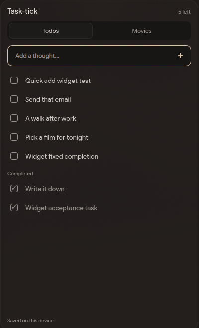

# Task-tick

The widgets and list styling are inspired by [TickTick](https://ticktick.com/). Task-tick is an independent project, with its own offline sync and desktop integration.

One todo list. One watchlist. Two compact widgets. A little more task-tick, a little more fantastic.

[Open the app](https://task-tick-beige.vercel.app/app) · [Downloads](https://task-tick-beige.vercel.app/downloads) · [Releases](https://github.com/wrestle-R/Task-tick/releases)

## Get it

**Android:** [Download the APK](https://task-tick-beige.vercel.app/downloads). Todos and Movies widgets are included in the app; add them through your launcher's widget picker.

**Desktop:** [Download Task-tick](https://task-tick-beige.vercel.app/downloads). Linux x86_64 packages are an AppImage and a Debian package. The downloads page only shows published releases, so it will say when a build is still being prepared.

Once a release is published, the Linux installer is:

```sh
curl -fsSL https://github.com/wrestle-R/Task-tick/releases/latest/download/install-app.sh | bash
```

It downloads Task-tick from this repository, verifies the release checksum and installs it for your user, without sudo. Run it again to update without deleting your lists. To inspect it before running, read [the installer](desktop/scripts/install-app.sh).

The AppImage checks for published updates and shows an **Update** button when a newer version is available. Updates verify the embedded signing key before installation and restart the app. Debian installations use the new package through your package manager. Android checks published releases too: **Update** downloads and verifies the APK, then opens Android's install confirmation. The operating system still controls permission and signature compatibility. These update paths require published release artifacts; tagged drafts are never offered as updates.

## Use it across your devices

| Platform | Available experience |
| --- | --- |
| Android | Bare native app, two home-screen list widgets, local reminders |
| Linux | Web app and native desktop source/packages; tray, background sync, optional desktop reminders |
| macOS | Web app in your browser; native macOS packages are not currently published |
| Windows | Web app in your browser; native Windows packages are not currently published |
| Hyprland + Quickshell | Optional sidebar sharing the Linux app's local store |

Sign in with the same email/password account on each device. Your data stays private to that account. Changes save locally, then sync when connected. Film and TV search uses TMDB; manual titles work too.

## Put your lists in a sidebar



The included integration is for Hyprland and the illogical-impulse Quickshell setup. It follows the existing desktop theme, keeps unfinished rows above recent completed rows, and hides overflowing completed rows without deleting anything. Movies has its own mode with TMDB autocomplete. Every opening starts on Todos. Space in an empty capture field toggles the configured Spotify player; spaces inside a task type normally.

Other desktop environments can implement their own panel using the same account/API contract. The Linux local socket is Linux-specific; it is not a Windows/macOS sidebar package. **Copy the prompt below into Codex or your coding agent** and attach this screenshot. The [full integration contract](docs/sidebar-integration.md) includes request bodies, account boundaries, offline rules and acceptance checks.

<details>
<summary>Copy-paste sidebar implementation prompt</summary>

```text
Build a Task-tick sidebar for my existing operating system and desktop setup.
Repository: https://github.com/wrestle-R/Task-tick
Backend: https://task-tick-beige.vercel.app
Reference screenshot: https://raw.githubusercontent.com/wrestle-R/Task-tick/main/docs/images/sidebar.png
Read docs/sidebar-integration.md, docs/architecture.md, packages/core/src/index.ts
and desktop/hyprland/TickDashboard.qml from that repository before coding.

First inspect my OS, desktop shell, panel framework, theme, existing shortcuts and
startup files. Preserve my existing panels and apps. Back up affected files and
make installation reversible. If my OS is not Linux, do not run Linux/Hyprland
commands: select a native panel mechanism for my OS and explain its limitations.

Visual layout, from top to bottom:
- Keep existing unrelated status/music panels in place.
- A small Task-tick header with unfinished count.
- Two compact theme-colored segments, Todos and Movies. Default to Todos every
  time the sidebar opens. No separate Completed tab.
- One compact add input with a small + button. Movies suggests film/TV titles
  from TMDB after 350ms and two typed characters; manual entry remains available.
- Compact unfinished rows ordered by position ascending, UUID as tie-breaker.
  New entries append at the bottom unless the user explicitly reorders them.
- Completed rows below unfinished rows, newest completions first. Only show as
  many as fit in spare panel space. Hide older completed rows from the panel;
  never delete, trash, or mutate those rows just to make the panel fit.
- Subtle saved/pending/error status. Match my panel's typography, roundness,
  colors and spacing. No stock black text fields or rectangular Qt buttons.
- No poster images in this small sidebar. Use posters in roomy app views only.

On Linux with Task-tick running, prefer its local store. The CLI reads/writes
one JSON request via: task-tick --ipc '<JSON>' (the optional Hyprland installer
uses the compatibility name tick-and-done). Detect which launcher is installed.
Read state with
{"action":"state"}; it returns items, outbox and _account. Every subsequent
write/search MUST include expectedAccount equal to that returned _account.
Add: {"action":"add","kind":"todo","title":"Buy coffee","expectedAccount":"UUID"}.
Toggle: {"action":"toggle","kind":"todo","id":"ITEM_UUID","expectedAccount":"UUID"}.
Search: {"action":"search","query":"Arrival","expectedAccount":"UUID"}.
For a selected movie result, add kind movie with title, tmdbId, mediaType
(movie or tv), and poster path. Duplicate TMDB entries return existingId.
Never read or write the SQLite file directly. Never expose session tokens in
commands, logs or screenshots. The local CLI does not return credentials.

For other platforms without the native store, implement an account-isolated
local store/outbox using the shared core protocol. GET /api/config returns the
publishable Supabase URL/key. Use Supabase email/password authentication and
refresh sessions normally. POST /api/sync uses Authorization: Bearer USER_TOKEN
and Content-Type: application/json. Reuse collectSyncPages/reconcile from the
core; do not hand-roll pagination or generate new mutation IDs on retries.
GET /api/movies?q=TITLE uses the same user Bearer token. No TMDB secret belongs
in the sidebar. Read the full contract for complete protocol examples.

Persist edits and outbox in one local transaction before showing success.
Isolate accounts; a pending request from A must never write into B. Preserve
unsynced edits for the same account on logout. Respect deletion-wins, field
merges, server acceptance ordering and seven-day Trash/recovery. Never hardcode
my login or request privileged database/service-role keys.

Bind Space to my existing Spotify toggle ONLY when the capture field is empty;
otherwise type an ordinary space. Scope this to the sidebar, never globally
intercept Space. Keep my existing global music shortcut intact. If my player
cannot restore its queue, report that limitation without inventing a queue.

Verify: offline add survives restart; reconnect creates one server item;
completion moves down; overflow hides old completed rows without deleting;
Movies autocomplete and manual add both work; duplicate TMDB entries reuse;
account switching clears old content; stale actions fail; empty-input Space
controls music, text-input Space types; install/uninstall preserves my setup.
Show me screenshots with sample data and report checks and remaining limits.
```

</details>

## Project details

[Setup and development](docs/setup.md) · [Architecture](docs/architecture.md) · [Verification](docs/verification.md) · [Progress and release gates](docs/progress/README.md)

Web and desktop controls use [Skeuomorphism UI](https://skeuomorphismui.vercel.app/). Movie metadata comes from TMDB. This product is not endorsed or certified by TMDB or affiliated with TickTick.
